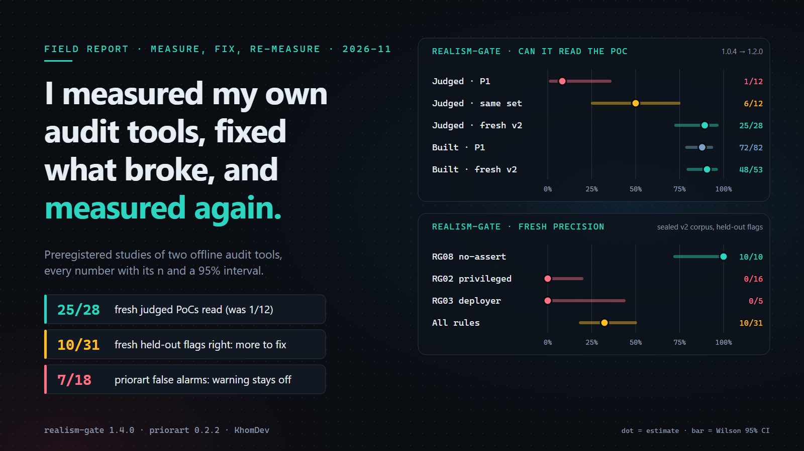

# I measured my own audit tools against real exploit proofs, fixed what broke, and measured again

*Every number is k/n with a Wilson 95% interval and comes from a committed results file in the
public repositories; the sources are listed at the end.*

I build two small, offline tools for smart-contract bug hunters. **realism-gate** reads a
proof-of-concept exploit test and flags the ways it proves less than it claims: the exploit step
is signed by an admin, a state write skips the program, the test asserts nothing.
**priorart** takes a finding and a dossier of earlier audit reports and returns the prior
items that look like the same bug, so a hunter reads them before submitting a duplicate.

This round was supposed to turn "measured once, honestly caveated" into evidence a reader can
re-run. Two of my own earlier claims failed on contact with a better search, both tools
measured worse than I would like on the data that matters, and CI paths I had "tested" on my
own machine held six defects that only real runners exposed. I am writing all of it down.

## Part 1: realism-gate on real Solana PoCs

### The claim that was wrong

The first Solana measurement ran on public test suites (Anchor, the Solana program examples,
LiteSVM, two SPL programs), because the write-up said a public PoC corpus "does not exist in a
form this tool reads". That conclusion came from checking three repositories. Test-suite
precision is the wrong population: a feature test signs as the admin because it is testing an
admin feature, so the privilege rules look terrible for a reason that says nothing about PoCs.

A second search took an afternoon. Public Solana exploit proofs written as tests exist in
judged contest repositories (Sherlock's Orderly and WOOFi judging, Code4rena's Pump Science),
in audit-bootcamp and CTF repositories (Ackee's Solana Auditors Bootcamp, Ackee's Breakpoint
2023 exploits, OtterSec's Breakpoint 2025 CTF), in teaching repositories that pair an
`exploit.ts` with a patched `secure.ts`, and in auditors' public portfolios. GitHub code search
for `LiteSVM attacker exploit` (Rust), `ProgramTest attacker exploit`, `bankrun attacker
exploit` and `anchor.workspace attacker exploit` (TypeScript) returned 77, 20, 26 and 58 hits.

### Study design

I wrote the preregistration before running the tool: frozen rule logic (realism-gate 1.0.4,
commit `6019773`), a seed, a hash-based split of flags into dev and held-out halves, the label
rubric, inclusion criteria, three tiers, and a rule that any cell with fewer than five labels
is reported as a count, never a percentage. The commit order proves the order: preregistration,
then the run, then the held-out labels, then the dev labels, then the second reader.

- **Tier J, judged PoCs (12 units)**: a platform or bounty outcome exists.
- **Tier X, exploit-by-construction (82 units)**: CTF solves, teaching exploit files,
  bootcamp PoCs, public PoCs of found bugs. The exploit is meant to work; no judge.
- **Negative controls (5 units)**: the `secure.ts` twins of five exploit files.

45 sources are pinned by commit and by a hash of their file listing; 309 candidates were
excluded with a reason, and 4 duplicates removed by content hash. No third-party text is
committed: the data is pointers, flag ids, labels and one-line reasons.

### Result 1: the tool cannot read the PoCs that platforms receive

| Tier | Readable units |
|---|---|
| Judged | 1/12 = 8.3% [1.5-35.4] |
| Exploit-by-construction | 72/82 = 87.8% [79.0-93.2] |

None of the 10 PoCs with a platform-published outcome is readable. Wardens write Rust unit
tests against instruction handlers directly (4), paste fragments with no test wrapper into
the issue (3), or submit TypeScript scripts rather than tests (3). realism-gate only checks a
test that drives a Solana harness (solana-program-test, LiteSVM, Mollusk, anchor-client, an
Anchor/web3.js/bankrun client), so it is silent on most of what a judge actually sees. That is
the most important finding of the round and it is not a precision number.

### Result 2: the assertion rules work, the identity rules do not

All 197 flags on PoCs were labelled. Held-out split, Rust and TypeScript pooled:

| Rule | What it flags | Held-out precision |
|---|---|---|
| RG08 | the test asserts nothing | 29/30 = 96.7% [83.3-99.4] |
| RG09 | a tautological assertion (`assert.ok(true)`) | 7/7 = 100% [64.6-100] |
| RG02 | a privileged step in the exploit path | 8/30 = 26.7% [14.2-44.5] |
| RG01 | the attacker holds a role | 2/12 = 16.7% [4.7-44.8] |
| RG04 | a direct state write | 0/16 = 0.0% [0.0-19.4] |
| RG06 | a fabricated account | 0/6 = 0.0% [0.0-39.0] |
| all rules | | 46/106 = 43.4% [34.4-52.9] |

RG05 and RG11 never fired on a PoC. They are unmeasured, not 100%.

Reading the false positives gives eight classes. The ones that matter:

1. **The "privileged" key is the attacker's own.** The attacker overflows its own vault, or
   signs for its own account. The rules see a signer called `owner` and stop.
2. **Secure-path tests inside exploit files.** Teaching files include a test that shows the
   attack failing. That test signs as the real authority by design.
3. **Fixture accounts the program then initialises.** Every one of the 29 RG04 flags was a
   test creating an account, zeroed or otherwise, that the program then acted on.
4. **The victim's precondition, written in setup.** A funded escrow is written directly and
   then drained through the program. This is the honest boundary: a stricter rubric could call
   it a true positive, because the drained balance never passed through the program's
   accounting.

The negative control behaves: all five exploit files were flagged (5/5) and one of five secure
twins (1/5), and that one has eight RG08 flags because its tests really do assert nothing.
Flags per checked test were 1.04 on the exploit side and 0.18 on the secure side.

A blinded second reader agreed on 29 of 30 sampled labels, Cohen's κ 0.927. Both readers are AI
models. That is disclosed, and it is not independent human validation.

### What the numbers do not say

The intervals are too narrow: 60 units raise all 197 flags and two teaching repositories raise
76 of them, while Wilson assumes independence. Without those two sources (a sensitivity row I
did not preregister) pooled precision is 41/121 = 33.9% [26.1-42.7]. CTF and teaching PoCs are
written to be read, not to win a payout, and their secure-path tests inflate the identity
rules' false positives. And with one readable judged PoC, I cannot say anything about whether a
flag tracks a judge's verdict.

### What shipped, and what is next

realism-gate 1.1.0 prints its measured precision per rule and language in `rules` and
`explain`, and those numbers are now the PoC held-out cells, not the test-suite ones. A cell
with fewer than five labels prints as `0/2 (n<5, count only)`. I applied that rule to every
language, which turned two Solidity cells that used to print as `0/1 = 0.0%` and `1/1 = 100.0%`
into counts. A unit test pins every embedded cell to the study's results file.

The rule logic did not change. Changing it during a measurement would invalidate the
measurement. The next version should read Rust unit tests that call handlers and pasted
fragments, skip secure-path tests, stop firing RG04/RG06 on fixtures the program initialises,
and downgrade RG01, RG04 and RG06 to notes on Solana. Each of those needs a new dated
measurement on a fresh split.

## Part 2: priorart on a second judging platform

### The benchmark

priorart's benchmark is a judged contest that published its prior audit and a later contest's
judging on the same code. The prior audit's High/Medium findings, plus the sponsor's known
issues, form dossier A. Three measurements:

- **False-alarm rate (FAR):** for findings the judge paid as new and unique, how often does
  the matcher return any prior item? Its rule is "any prior item sharing at least two strong
  identifiers", so any returned item is a claim of shared prior art.
- **Duplicate recall@5:** for a submission the judge grouped as a duplicate, is the
  representative in the top five against dossier B (all the judged representatives)?
- **Known-prior recall@5:** for an excluded finding that repeats one prior item, is that item
  in the top five?

A preregistered trigger governs the duplicate warning: above 30% false alarms, the tool ships
retrieval-only.

### The second claim that was wrong

Both earlier corpora, Tapioca and PoolTogether V5, are a Code4rena prior audit judged later
on Sherlock. The docs said that pair was "the only public combination found that publishes
both judge-grouped duplicate submissions and excluded findings". Code4rena publishes its
judging as labels on every issue of the public findings repository: `duplicate-N` is the
judge's grouping, `H-01`/`M-03` mark the paid findings, and `satisfactory`, `unsatisfactory`,
`partial-*` and `downgraded by judge` are all there. I listed 376 public findings repositories.

### Building Code4rena corpora without changing the matcher

I added one source type to the fetch script. It reads every issue once and writes the judge's
decisions into the same on-disk layout the Sherlock corpora use: one folder per paid finding
holding its duplicates, and `invalid/` for everything excluded. The scoring code and the
matcher do not know which platform they are looking at. The mapping rules:

- **In scope:** issues with a High/Medium label, a report id, or `downgraded by judge`. QA/Gas
  reports and withdrawn issues are out.
- **Groups:** the transitive closure of `duplicate-N`.
- **Paid groups:** a group is paid if any member carries a report id, and that member is its
  representative. Everything else is excluded, including High/Medium submissions downgraded to
  QA.

Issues are not in git, so the lock file pins the sha256 of every generated file; an edited
issue shows up as drift.

I checked the mapping against the contests' own published reports before labelling anything:
26 of 26 paid findings matched one-to-one with the same severity.

Selection was by rules written first: two public Code4rena contests on the same protocol, at
least 30 judge-grouped duplicates, at least 20 excluded findings, at least half the later
contest's files present in the earlier one, and then the two with the most paid findings.
Thirteen pairs were screened. **Maia** (2023-05 → 2023-09; 79 prior High/Medium items, 15 paid,
289 duplicates) and **Panoptic** (2023-11 → 2024-04; 7 prior items plus 21 known-issue lines,
11 paid, 80 duplicates) won.

### Results

The matcher was frozen at priorart 0.2.0 (binary `06fdf195…`, unchanged since 0.1.3). The dev
split was run first to write the freeze, then the full corpus. There were 0 tool errors.

| Corpus | Judged by | False-alarm rate | Duplicate recall@5 |
|---|---|---|---|
| Tapioca | Sherlock | 15/60 = 25.0% [15.8-37.2] | 36/64 = 56.3% [44.1-67.7] |
| PoolTogether | Sherlock | 9/40 = 22.5% [12.3-37.5] | 32/85 = 37.6% [28.1-48.3] |
| Maia | Code4rena | 8/15 = 53.3% [30.1-75.2] | 87/289 = 30.1% [25.1-35.6] |
| Panoptic | Code4rena | 6/11 = 54.5% [28.0-78.7] | 38/80 = 47.5% [36.9-58.3] |
| Maia + Panoptic | Code4rena | 14/26 = 53.8% [35.5-71.2] | 125/369 = 33.9% [29.2-38.9] |

**The trigger is met for the first time.** On both Sherlock corpora the interval straddled 30%.
On Maia, and on the preregistered pool, the whole interval is above it. On Code4rena-judged
contests the frozen matcher returns a prior item for about half of the findings the judge paid
as new. I read every alarm. Each Panoptic alarm returned the prior "partial transfers corrupt
storage" finding, and none of the six findings says that. None of the Maia alarms restates the
prior item it returned either. The warning stays off, and the two-identifier rule is now
measurably the weak part.

Why Code4rena is worse is not established. The likeliest factor is dossier size: Maia's prior
dossier has 108 items against PoolTogether's 11, and more items give a two-identifier rule
more chances to fire. Two corpora cannot separate that from the platform.

Known-prior recall is still unmeasurable. The seeded samples of 20 excluded findings per corpus
held four that repeat a prior item, and none came back in the top five. Four is a count, not a
rate.

### A harness defect the new corpora exposed

The harness cuts the prior report into one file per High/Medium heading. The last slice runs to
the end of the report, so it also carries the Low/QA and gas sections. On Maia that slice
became 15 dossier items, and one alarm came only from a Low finding ("missing event for
initialize"). It affects all four corpora. I did not change the frozen harness after measuring.
The published numbers stand, and a sensitivity row I did not preregister gives Maia 7/15 =
46.7% [24.8-69.9] and the pool 13/26 = 50.0% [32.1-67.9] without that alarm. The conclusion does
not move. The fix needs a new dated measurement of all four corpora.

### What is honest about the labels

The paid and duplicate labels are the judges' own. Only the known-prior labels are a reader's:
one AI reader on the full text, and a separate blinded AI reader on titles and the prior-item
list. They agreed 19/20 on each corpus (38/40 = 95.0% [83.5-98.6]). The blind reader's answers
for Maia reached me before I had written my Maia labels, so for that corpus only the second
reader was blind. The labels file says so.

## Part 3: shipping it

realism-gate's release pipeline had grown in this round: deterministic archive repacking, a
provenance check in the GitHub Action, and a workflow that rebuilds a tag and compares the
hashes. All of it had passed on my Windows machine. The first CI run found five defects:

1. The checksum job read the version from a job it did not list as a dependency, so the
   version was an empty string and it looked for `realism-gate--x86_64-…`.
2. The Windows zip was written to a relative path from inside the staging directory.
3. The test's fake `gh` was not executable, so on Linux and macOS `command -v gh` skipped it
   and found the runner's real `gh`. Windows ignores the execute bit, which hid this.
4. CI's crate-content allowlist did not know about the measured-precision file the crate embeds.
5. The zip determinism test staged `realism-gate` where the zip step expects
   `realism-gate.exe`. It had never passed anywhere, because my machine has no `zip`.

The mandatory release dry run caught the first two before any tag existed. After the fixes, the
tag workflow, `verify-release` (install from crates.io and from the archives on four platforms,
the Action on three) and the reproducibility check all passed. **realism-gate 1.1.0 rebuilds
byte-for-byte**: three binaries and the archive match the released hashes. It is the first
release that could pass that check. I also found that the Action's floating `v1` tag had been
left on 1.0.3, so `@v1` users never got 1.0.4. It points at 1.1.0 now.

priorart 0.2.1 changes no crate code. It is an evidence release: the two new corpora, the
second Sherlock corpus, the corrected platform claim, and a README that leads with the
above-trigger result. Its CI found a sixth defect of the same kind. A Unix-only test case had
not compiled since 0.2.0, so the Linux, macOS and MSRV jobs had been red since that release.
Windows skips the case, which is why I never saw it.

## Part 4: Fixing it

P1-C fixed the readers and the false positives the PoC study found, tested
each change, re-measured on the same PoCs, and collected a sealed fresh corpus
for the out-of-sample number. Nothing in this part changes the P1 numbers
above; they are added beside them, with dates and populations.

### What the readers do now

- **A Rust `#[test]` that calls program functions directly.** The direct call
  is modelled as the exploit transaction; the accounts the test builds are
  fixtures and `is_signer` flags on `AccountInfo`s are the identities. This
  was 4 of the 10 judged PoCs the 1.0.4 tool could not read.
- **A Rust `fn main` that drives a PoC framework** (`poc-framework`,
  `LocalEnvironment`, `Environment::…_client`). `execute_as_transaction` is a
  transaction with its signers and instructions.
- **A TypeScript script** that drives an Anchor/web3.js/LiteSVM client: the
  top-level statements (or `main()`) are one test.
- **A pasted fragment**: `check --fragment <file>` wraps bare statements as
  one test body; a file given explicitly with no top-level test is
  auto-detected. The output says `fragment: true`.

### Coverage: in-sample and fresh

| Tier | P1 (1.0.4) | P1-C same PoCs (1.2.0) | P1-C fresh v2 (1.2.0) |
|---|---|---|---|
| Judged | 1/12 = 8.3% [1.5-35.4] | 6/12 = 50.0% [25.4-74.6] | **25/28 = 89.3% [72.8-96.3]** |
| Exploit-by-construction | 72/82 = 87.8% [79.0-93.2] | 82/82 = 100% [95.5-100] | 48/53 = 90.6% [79.8-95.9] |
| All (J + X) | 73/94 = 77.7% [68.2-84.9] | 88/94 = 93.6% [86.8-97.0] | 73/81 = 90.1% [81.7-94.9] |

The "All" row counts judged and exploit-by-construction units only, so the three columns share
a definition. The P1 set also holds five negative controls; 1.2.0 reads all five (93/99 with
them included), but they are not exploit PoCs and are left out of the comparison.

The fresh corpus (v2) was collected, pinned and committed before the first
`src/` change: 81 counted units, 28 judged (Solana Audit Arena maintainer
labels and Immunefi Jito Restaking audit-competition reports) and 53
exploit-by-construction. It is the headline; the same-PoC column is an
in-sample re-measurement and is labelled so.

**The judged-readability target on the P1 set was >= 8/12; the result is
6/12 and I missed it** (the 1.4.0 binary re-check is still 6/12). Still
unreadable: a bare fragment that does not parse as a test body, one `it()`
block rejected by the file-level Solana import gate, two scripts whose Anchor
import is one level away in `utils.ts`, one pure fee simulation that drives no
client, and one portfolio whose harness is not included.

### The eight false-positive classes

Each class has a must-not-fire fixture and a paired must-fire twin in
`tests/p1c_fixes.rs`, named after the class: the attacker's own key is not
privileged; a control test does not fire the identity/state rules (RG08 still
does); a fixture the program initialises is not a write; a precondition
fabricated in setup is a note beginning `Precondition fabricated:`; a
configuration test is setup for the tests after it; an attacker-signed grant
is the attack, not the harness; a read of the same account before the attack
is a baseline; and RG08's scope is the exploit's outcome, not "anywhere".

On the P1 PoCs the flags fall from 205 to 144. 86 disappear: 77 were P1 false
positives, 9 were P1 true positives. Six of the nine are RG08 on setup/init
steps, which the new scope excludes; three are RG01 on the attacker draining
its own vault, which the class-1 fix reads as the attacker's own account. The
second group is a conflict in my own instructions, and I am not hiding it: the
class-1 fix and the P1 true-positive list disagree about that pattern.

### Severity, after the fresh precision round

RG01, RG04 and RG06 ship at **note** on Solana in 1.2.0. A rule ships above
`note` only when its fresh held-out Wilson lower bound is at least 0.80; a test
reads `measured.json` and fails when that floor is broken.

Then I labelled the held-out half of the sealed corpus (1.3.0, after two fixes
found on the dev half alone). **RG08 is 10/10; RG02 is 0/16; RG03 is 0/5**
(one RG09 flag was unclear). The pooled held-out cell is 10/31 = 32.3%
[18.6-49.9], source-clustered bootstrap [10.0-72.7]. The label reasons show
two defects, not one:

- **RG02, 13 of 16:** the "authority" is a key the test creates to own its own
  account. The tool reads any signing authority as a privileged role, so an
  attacker managing its own account looks like an admin step. The P1-C
  class-1 fix (the attacker's own key is not privileged) did not generalise
  to these harnesses. The other three are a market creator acting on its own
  market, a deployer calling an ungated function, and a setup helper.
- **RG03, all 5:** a single-payer transaction (a deposit, a stake) read as
  privileged, because the static reader cannot yet tell a fee payer from a
  role signer.

Both are the same underlying gap: the tool guesses who holds authority from
the test, instead of reading what the program actually requires. A rule at
`warn` with that record is noise, so 1.4.0 moves RG01, RG02, RG03, RG04 and
RG06 to `note` on Solana.

Applying the floor honestly also demoted the rule that looked best. RG08 is
right on all ten held-out flags, but 10/10 has a Wilson lower bound of 0.7225,
below the 0.80 the policy requires for `error`; RG09's one fresh flag was
unclear. Both ship at `warn` in 1.4.0, so no Solana rule ships at `error`.
RG08 returns there at 16/16, where the lower bound reaches 0.8064. The floor
test now reads the fresh measurement instead of a file with no fresh cells;
before this round it passed vacuously. That defect is worth stating plainly:
the policy was written, tested, and not actually enforced.

### NEAR: searched, not measurable yet

The same search on NEAR's PoC sets (NEAR examples, audit repositories and the
`near-workspaces` ecosystem) found no judged corpus: no public NEAR contest or
bounty publishes judge-grouped coded PoCs in a form the corpus can pin. The
exploit-by-construction tier has one unit — a replay harness whose nine tests
replay a Lean model's attack traces and assert the replayed state — and the
harness smoke test is excluded because it proves the sandbox works, not an
attack. There is no NEAR front end in realism-gate, so the corpus is pinned and
counted (`eval/near-poc-v1/`) and not measured. Building the front end is the
precondition for a NEAR precision row; I am not inventing the number.

### priorart: a redesign that failed

The 0.3.0 matcher required a shared claim component (a shared symbol unique to
one prior item, or a shared file) and an absolute document frequency, and it
counted heading identifiers and joined wrapped known-issues bullets. Measured
on four in-sample corpora and two sealed ones:

| Corpus | FAR | Duplicate recall@5 |
|---|---|---|
| Maia (in-sample) | 8/15 = 53.3% [30.1-75.2] | 7/289 = 2.4% [1.2-4.9] |
| Panoptic (in-sample) | 6/11 = 54.5% [28.0-78.7] | 3/80 = 3.8% [1.3-10.4] |
| Party (sealed) | 3/9 = 33.3% [12.1-64.6] | 0/132 = 0.0% [0.0-2.8] |
| Wildcat (sealed) | 3/9 = 33.3% [12.1-64.6] | 9/46 = 19.6% [10.7-33.2] |
| Sealed pooled | 6/18 = 33.3% [16.3-56.3] | 9/178 = 5.1% [2.7-9.3] |

The false-alarm rate does not fall below the 30% trigger on the sealed
corpora, and duplicate recall collapses (Maia 30.1% -> 2.4%). The claim
component is the wrong lever: judge-grouped duplicates share common function
names with several representatives, so they have no unique shared symbol and
often no shared path. The harness fixes are keepers; the alarm gate is not,
and the warning stays off.

What shipped is 0.2.2: the 0.2.1 matcher with the harness fixes and without
the alarm gate. Its numbers on the same two pairs, which were opened by the
0.3.0 run and so count as in-sample from here on:

| Corpus (priorart 0.2.2, shipped) | FAR | Duplicate recall@5 |
|---|---|---|
| Party | 3/9 = 33.3% [12.1-64.6] | 40/132 = 30.3% [23.1-38.6] |
| Wildcat | 4/9 = 44.4% [18.9-73.3] | 23/46 = 50.0% [36.1-63.9] |
| Pooled | 7/18 = 38.9% [20.3-61.4] | 63/178 = 35.4% [28.7-42.7] |

So the shipped matcher retrieves about a third of judge-grouped duplicates in
its top five, and its alarm is wrong on roughly two in five unique findings on
these pairs: a reading aid, not a verdict. The next priorart lever needs a new sealed corpus
pair first: Party and Wildcat were the fresh measurement and are in-sample
from this round on, so nothing left in the workspace can support a fresh
precision claim.

### What was tested, and what was not

- realism-gate: fmt and clippy clean; **373 tests pass, 0 fail, 2 ignored**,
  including 26 class/reader/property tests and five severity-floor tests;
  docs and README example blocks regenerated.
- priorart: fmt and clippy clean; **152 tests pass, 0 fail**; the benchmark
  self-test covers the slice and the known-issue join; README examples and
  dossier fixtures regenerated.
- **Not done:** sanitizers and the full mutation scope still have no numbers,
  and the human-label packet exists but no human has filled it. 1.4.0's CI
  and first coverage number are in the Limits section below.

## What comes next

This is not the end state of either tool. The work continues, and the next releases target
precision directly, because that is where the numbers above are weakest. Each target below names
the defect it addresses, and none of them will be claimed until it is measured on a corpus sealed
before the code was written, the same way as this round.

- **realism-gate: read the program's access control instead of guessing it.** RG02 and RG03 were
  wrong on all 21 fresh held-out flags: an attacker's own account authority read as an admin
  (13), and a fee payer read as a role signer (5). Reading the program's own signer and
  authority constraints (Anchor `Signer`/`has_one`/`constraint`, native `is_signer` checks)
  and keeping the payer separate from the authority should turn them from noise into a real
  signal; until then they ship at `note`.
- **realism-gate: a semantic model of the PoC instead of pattern rules.** The next architecture
  reads each PoC as a sequence of transactions with actors, accounts and asserted outcomes, and
  every rule becomes a query on that model. That is how the identity rules stop guessing.
- **realism-gate: more judged data, labelled by humans.** A second sealed corpus from more than
  one judged source, and independent human labels with published agreement, so the precision
  numbers stop depending on one AI reader and one platform.
- **priorart: a better alarm, measured on a fresh pair.** The claim-component gate failed; the
  next rule ranks by what a finding asserts (the vulnerable function, the broken invariant, the
  impact), and it gets a new sealed contest pair before it gets a number.

I will publish the next measurement the same way as this one: with n, intervals, the misses and
the commit order. If a fix does not raise fresh precision, that will be the headline.

## What I am taking from this

- **A "does not exist" claim needs a search log.** Both wrong claims came from stopping a search
  early and writing the stopping point as a fact. The corrections are in the docs, next to the
  claims they replace.
- **Commit order is a cheap preregistration.** Plan, then run, then labels, then second reader,
  each in its own commit. It does not make the labels right, but it makes the order checkable.
- **Count what the tool cannot read.** realism-gate's precision is a number about the PoCs it
  reads. The 11 of 12 judged PoCs it cannot read are the more important number.
- **A CI path that has never run is not tested, and a red CI that nobody reads is the same.**
  There were six defects. My machine caught none of them; real CI runs caught all six. The
  dry-run-before-tag rule caught two before any tag existed. One had sat in a red `main` for a
  whole release.

## Limits

- Two protocols per platform for priorart, and 12 judged PoCs for realism-gate. None of this is
  a population estimate.
- The labellers are AI models. In P1 there was one primary and one blinded second reader; the
  P1-C v2 held-out labels (the 31 flags behind 10/31) were written by **one AI reader with no
  second reader and no kappa**. None of it is independent human validation. A blind human packet for the 32 held-out flags now exists
  (`eval/solana-poc-v2/labels/HUMAN_PACKET.md`) with a scorer for agreement and Cohen's kappa,
  but no human has returned it, so no human-labelled number appears anywhere in this post.
- Both tools are measured at frozen versions, and each fresh number names its
  version: realism-gate 1.0.4 (P1) and 1.2.0/1.3.0 (P1-C), priorart 0.2.0
  (P1) and 0.2.2 (P1-C). Numbers from different versions are never pooled.
- I wrote both tools and both rubrics. The preregistrations and the commit order are the
  mitigation, not a substitute for an outside reviewer. No external audit or user study has
  happened.
- **Part 4's fresh precision is one round, and it is small.** The sealed v2
  held-out split carries 31 labelled flags from 6 sources: RG08 10/10, RG02
  0/16, RG03 0/5, one unclear RG09. The other rules have no fresh cell, and a
  rule-level Wilson interval over one source cluster is not a population
  estimate. The in-sample table is never merged with the fresh one.
- **The P1 judged-readability target was missed (6/12 against 8/12),** and the
  1.4.0 reader re-check does not move it; the redesign of the priorart alarm
  also did not work: on the then-sealed pairs it
  measured 33.3% false alarms and duplicate recall collapsed. The reverted
  0.2.2 measures 38.9% on those pairs, now in-sample, so the warning stays
  off. Both are results, not footnotes.
- **CI on 1.4.0:** the test suite is green on Linux, macOS and Windows, plus
  MSRV, package and audit jobs (run 45690712773). Line coverage was measured for
  the first time: 89.6% (run 45690717533). The repaired fuzz workflow runs again (run 45690709031): five of six targets pass five-minute runs; the TypeScript target trips a `debug_assert!` inside the upstream oxc parser (`trivia_builder.rs:62`). Release builds compile that assertion out, so the shipped binary does not panic on the input, but the job stays red and it is an open item. Sanitizer and full
  mutation runs still have no numbers.

## Reproduce

- realism-gate ([github.com/KhomDev/realism-gate](https://github.com/KhomDev/realism-gate)):
  - Studies: [`eval/solana-poc/`](https://github.com/KhomDev/realism-gate/tree/main/eval/solana-poc) (P1) and [`eval/solana-poc-v2/`](https://github.com/KhomDev/realism-gate/tree/main/eval/solana-poc-v2) (the sealed P1-C corpus), each with `PREREGISTRATION.md` and `RESULTS.md`; `measure.py` runs offline.
  - Precision page: [`docs/precision.md`](https://github.com/KhomDev/realism-gate/blob/main/docs/precision.md).
  - Release: [v1.4.0](https://github.com/KhomDev/realism-gate/releases/tag/v1.4.0), `cargo install realism-gate`.
- priorart ([github.com/KhomDev/priorart](https://github.com/KhomDev/priorart)):
  - Benchmark and every corpus: [`eval/benchmark/BENCHMARK.md`](https://github.com/KhomDev/priorart/blob/main/eval/benchmark/BENCHMARK.md); `fetch.py --corpus-dir … --check` and `run.py --corpus-dir … --check` run offline.
  - Release: [v0.2.2](https://github.com/KhomDev/priorart/releases/tag/v0.2.2), `cargo install priorart`.
